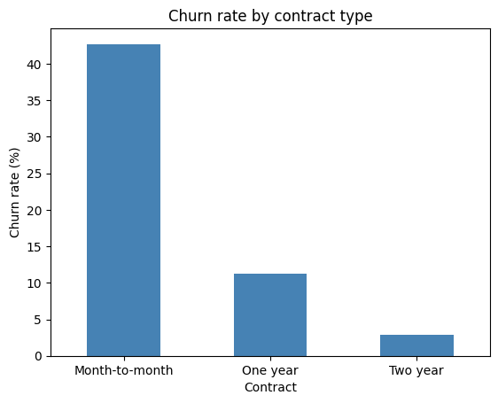
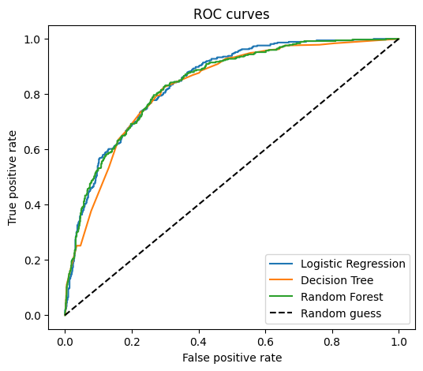
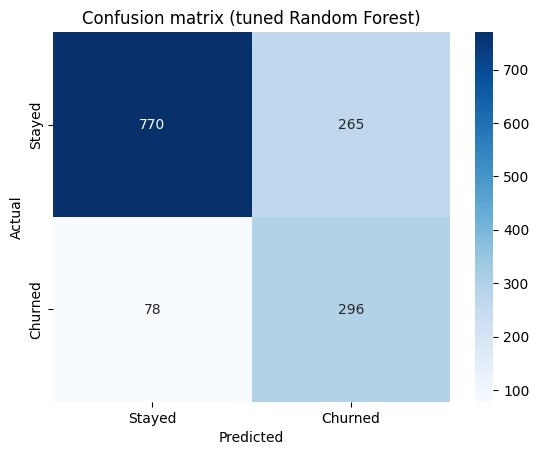
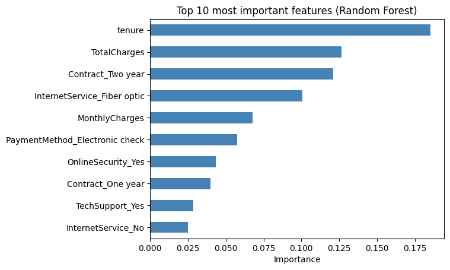

<h1 align="center">📉 Customer Churn Prediction</h1>

<p align="center">
  <b>Which telecom customers are about to leave, and why?</b><br>
  My first end-to-end machine learning project.
</p>

<p align="center">
  
  
  
  
  
</p>

<p align="center">
  📓 <a href="Churn_Analysis.ipynb"><b>View the notebook</b></a>
</p>

---

## ⚡ TL;DR

> I trained a **Random Forest** that catches **79% of the customers who churn** (ROC-AUC **0.845**).
> The biggest warning signs: **month-to-month contracts**, **new customers**, **fiber optic internet** and **electronic check payments**.

| 🧮 Customers | 📊 Churn rate | 🤖 Models compared | 🏆 Final model |
|:---:|:---:|:---:|:---:|
| 7,043 | 26.5% | 3 | Tuned Random Forest |

---

## 🔍 What the data shows

**Contract type is the strongest signal:**

| Contract | Churn rate |
|---|:---:|
| Month-to-month | **42.7%** |
| One year | 11.3% |
| Two year | 2.8% |

<p align="center">
  
</p>

- ⏳ **New customers leave more:** churned customers had an average tenure of **18 months**, versus **37.6 months** for customers who stayed.
- 📡 **Fiber optic customers churn more:** 41.9%, compared to 19.0% for DSL and 7.4% for customers with no internet service.
- 💳 **Electronic check** payment is also linked to higher churn.

---

## 🏆 Model results (test set)

| Model | Accuracy | Precision | Recall | F1 | ROC-AUC |
|---|:---:|:---:|:---:|:---:|:---:|
| Logistic Regression | 73.8% | 50.4% | 78.3% | 61.4% | 84.2% |
| Decision Tree | 73.8% | 50.4% | 81.8% | 62.4% | 82.6% |
| Random Forest | 77.6% | 56.5% | 67.1% | 61.4% | 83.8% |
| **Random Forest (tuned)** ⭐ | 75.7% | 52.8% | **79.1%** | **63.3%** | **84.5%** |

> [!NOTE]
> Only 27% of customers churn, so accuracy alone is misleading. A model that says "nobody churns" would already get about 73% accuracy. That's why I focus on **recall** (how many churners we catch), **precision**, **F1** and **ROC-AUC**.

<p align="center">
  
  &nbsp;
  
</p>

The tuned model correctly finds **296 of the 374 churners** in the test set, at the cost of 265 false alarms.

### 🛠️ Fixing overfitting

The first Random Forest memorised the training data: **train AUC 0.97 vs test AUC 0.84**. I used `GridSearchCV` and found that requiring at least 20 customers in each leaf (`min_samples_leaf=20`) fixed most of the problem (**train 0.88 vs test 0.845**) and raised recall from **67% to 79%**.

---

## 🌟 What drives churn?

<p align="center">
  
</p>

The top features are **tenure**, **TotalCharges**, **Contract_Two year** and **fiber optic internet**. This matches what I found during exploration. (Random Forest importance can favour numeric columns, so I treat this as a rough guide, not exact numbers.)

---

## 🧭 How I did it

<details>
<summary><b>Click to see the steps</b></summary>

1. **Cleaned the data:** `TotalCharges` was stored as text because of a few blank values. All of them were brand-new customers (`tenure = 0`), so I filled them with 0.
2. **Explored the data:** plots of churn by contract, tenure, monthly charges and internet service.
3. **Prepared the data:** one-hot encoding, an 80/20 stratified train-test split, and scaling of the numeric columns.
4. **Trained 3 models:** Logistic Regression, Decision Tree and Random Forest (with `class_weight="balanced"` because the data is imbalanced).
5. **Checked reliability:** 5-fold cross-validation and train vs test scores to spot overfitting.
6. **Tuned the Random Forest** with `GridSearchCV`.
7. **Interpreted the result:** confusion matrix, different decision thresholds and feature importance.

</details>

---

## 💡 Suggestions for the company

- Offer discounts or benefits to move **month-to-month** customers to longer contracts.
- Pay extra attention to customers in their **first months**.
- Find out why **fiber optic** and **electronic check** customers leave more often.

---

## 🚀 How to run

1. Download this repository (green **Code** button, then **Download ZIP**) and unzip it.
2. Install the libraries:
   ```bash
   pip install pandas numpy matplotlib seaborn scikit-learn jupyter
   ```
3. Start Jupyter and open `Churn_Analysis.ipynb`:
   ```bash
   jupyter notebook
   ```
4. Keep `Churn.csv` in the **same folder** as the notebook, then choose **Run → Run All Cells**.

---

## 📂 Dataset

**Telco Customer Churn** (an IBM sample dataset), 7,043 customers and 21 columns.
Download it from [Kaggle](https://www.kaggle.com/datasets/blastchar/telco-customer-churn).

---

## ⚠️ Limitations and next steps

- The data is a single snapshot, so I can't tell how the model would perform on future customers.
- The analysis shows relationships, not proof of what *causes* churn.
- The threshold table in the notebook is evaluated on the test set, which is fine for illustrating the trade-off but not for choosing a final threshold.
- Next I want to try other models (e.g. XGBoost) and explain individual predictions with SHAP.

---

## 👤 Author

**Mohammad Abdullah**
GitHub: [@Abdullah87146](https://github.com/Abdullah87146)

<p align="center"><i>⭐ If you found this project useful, feel free to give it a star!</i></p>
